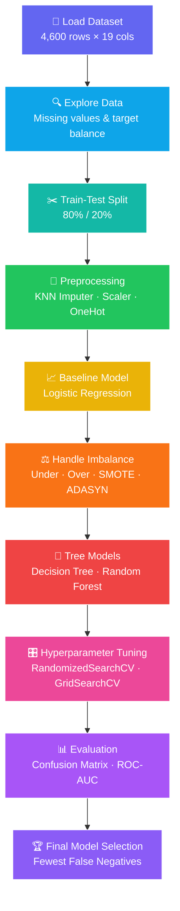

<h1 align="center">🚨 Risk Alert Classifier</h1>

<p align="center">
  <b>Credit-risk classification with Logistic Regression, Decision Tree &amp; Random Forest — including imbalance handling, hyperparameter tuning and ROC analysis.</b>
</p>

<p align="center">
  
  
  
  
  
</p>

---

## 🔗 Project Links

> 👉 Replace `YOUR_PDF_LINK_HERE` and `YOUR_VIDEO_LINK_HERE` below with your real links (Google Drive, YouTube, etc.).

<p align="center">
  <a href="YOUR_PDF_LINK_HERE"></a>
  &nbsp;
  <a href="YOUR_VIDEO_LINK_HERE"></a>
  &nbsp;
  <a href="main.ipynb"></a>
</p>

| Resource | Link |
|---|---|
| 📄 **Part A – Theory PDF** (concepts, formulas, graphs) | [Click here to open the PDF](https://drive.google.com/file/d/1SGNMYczR4MBlkgZFDZCGrQnkfpoE_0WB/view?usp=sharing) |
| 🎥 **Project explanation video** | [Click here to watch the video](YOUR_VIDEO_LINK_HERE) |
| 📓 **Code notebook** | [`main.ipynb`](main.ipynb) |
| 🗂️ **Dataset** | [`Risk_Alert_Classifier_Dataset.csv`](Risk_Alert_Classifier_Dataset.csv) |

---

## 🌈 Project Workflow


---

## 📌 Overview

The **Risk Alert Classifier** predicts whether a bank customer is **High Risk (1)** or **Low Risk (0)** from their profile, credit behaviour and account activity. The project walks through the full machine-learning cycle: data understanding, preprocessing, a Logistic Regression baseline, handling class imbalance, tree-based models, hyperparameter tuning, ROC/AUC analysis and final model selection.

Because missing a risky customer (a **False Negative / Type-II error**) is far more costly than wrongly flagging a safe one (a **False Positive / Type-I error**), the final model is chosen by **fewest false negatives first**, not by accuracy alone.

## 🎯 Objectives

- Understand and prepare a customer dataset that contains missing values and mixed data types.
- Build a **Logistic Regression baseline** and evaluate it with confusion matrix, Precision, Recall and F1-Score.
- Demonstrate the impact of **class imbalance** and fix it with Under-Sampling, Over-Sampling, SMOTE and ADASYN.
- Train **Decision Tree** and **Random Forest** classifiers and analyse overfitting.
- Tune models using **RandomizedSearchCV** and **GridSearchCV**.
- Compare all models using **ROC curves and AUC-ROC**, then select the final model by minimising false negatives.

## ✨ Key Features

- ✅ Leak-safe preprocessing — imputer, scaler and encoder are **fit on training data only**
- ✅ `Pipeline` + `ColumnTransformer` for clean, reusable preprocessing
- ✅ KNN-based multivariate imputation for numerical features
- ✅ Four resampling strategies applied to **training data only**
- ✅ Recall-focused hyperparameter tuning (`scoring="recall"`)
- ✅ Single ranking table that sorts models by False Negatives → Recall → AUC
- ✅ Every code block is followed by its output and a written interpretation

## 🗂️ Dataset Information

| Property | Value |
|---|---|
| File | `Risk_Alert_Classifier_Dataset.csv` |
| Rows × Columns | **4,600 × 19** (18 input features + 1 target) |
| Target | `risk_status` → `0` = Low Risk, `1` = High Risk |
| Class balance | 4,043 Low Risk (**87.89%**) vs 557 High Risk (**12.11%**) → **imbalanced** |
| Numerical features | `customer_id`, `age`, `annual_income_inr`, `credit_score`, `credit_utilization_ratio`, `missed_payments_12m`, `avg_late_payment_days`, `monthly_transaction_count`, `monthly_spend_inr`, `cash_advance_count_6m`, `complaints_last_6m`, `failed_login_attempts_3m`, `account_tenure_months`, `debt_balance_inr` |
| Categorical features | `gender`, `region`, `employment_type`, `last_transaction_date` |

**Missing values per column**

| Column | Missing | Column | Missing |
|---|---:|---|---:|
| `age` | 140 | `credit_utilization_ratio` | 147 |
| `region` | 102 | `monthly_spend_inr` | 129 |
| `employment_type` | 144 | `credit_score` | 216 |
| `annual_income_inr` | 166 | all other columns | 0 |

## 📚 Libraries Used & Their Purpose

| Library | Purpose in this project |
|---|---|
| `pandas` | Load the CSV, inspect data, build comparison tables |
| `numpy` | Numerical operations and column-type selection |
| `matplotlib` | Plot bar charts, ROC curves and the confusion matrix figure |
| `seaborn` | Annotated heatmap for the confusion matrix |
| `sklearn.model_selection` | `train_test_split`, `RandomizedSearchCV`, `GridSearchCV` |
| `sklearn.impute` | `KNNImputer` (numeric) and `SimpleImputer` (categorical / median) |
| `sklearn.preprocessing` | `StandardScaler` and `OneHotEncoder` |
| `sklearn.compose` / `pipeline` | `ColumnTransformer` and `Pipeline` to chain preprocessing steps |
| `sklearn.linear_model` | `LogisticRegression` (baseline model) |
| `sklearn.tree` / `ensemble` | `DecisionTreeClassifier`, `RandomForestClassifier` |
| `sklearn.metrics` | Confusion matrix, accuracy, precision, recall, F1, ROC-AUC, ROC curve |
| `scipy.stats` | `randint` distributions for randomized search |
| `imblearn` | `RandomUnderSampler`, `RandomOverSampler`, `SMOTE`, `ADASYN` |

---

## 📖 Part A — Conceptual Understanding (Theory)

Full explanations with formulas and graphs are in the **[Theory PDF](YOUR_PDF_LINK_HERE)**. Quick summary:

| # | Topic | Key idea |
|---|---|---|
| 1 | Logistic Regression | Passes a linear score through the sigmoid, $P(y=1\mid x)=\frac{1}{1+e^{-z}}$, to get a probability; trained with log-loss |
| 2 | Classification metrics | Accuracy, Precision, Recall, F1, ROC-AUC come from the confusion matrix; accuracy alone fails on imbalanced data |
| 3 | Type-I vs Type-II error | Type-I = False Positive (safe customer flagged risky); Type-II = False Negative (risky customer approved) — costlier in risk prediction |
| 4 | Precision, Recall, F1, TPR, FPR | $Precision=\frac{TP}{TP+FP}$, $Recall=\frac{TP}{TP+FN}$, $F1=\frac{2PR}{P+R}$, $FPR=\frac{FP}{FP+TN}$ |
| 5 | AUC-ROC | Area under TPR-vs-FPR curve; 1.0 = perfect, 0.5 = random; threshold-independent |
| 6 | Imbalanced data | Model becomes biased to the majority class; fix with resampling, class weights, threshold tuning |

---

# 💻 Part B — Dataset Understanding & Preparation

## Step 1 · Import Libraries

**Explanation:** All required libraries for data handling, preprocessing, modelling, balancing, tuning and evaluation are imported once at the top.

**Objective:** Prepare the environment for the full workflow.

**Code**
```python
import pandas as pd
import numpy as np
import matplotlib.pyplot as plt
import seaborn as sns

from sklearn.model_selection import train_test_split
from sklearn.impute import KNNImputer, SimpleImputer
from sklearn.preprocessing import StandardScaler, OneHotEncoder
from sklearn.linear_model import LogisticRegression
from sklearn.compose import ColumnTransformer
from sklearn.pipeline import Pipeline
from sklearn.base import clone
from sklearn.tree import DecisionTreeClassifier
from sklearn.ensemble import RandomForestClassifier
from sklearn.metrics import (confusion_matrix, classification_report, accuracy_score,
                             recall_score, precision_score, f1_score,
                             roc_auc_score, roc_curve)
from sklearn.model_selection import RandomizedSearchCV, GridSearchCV
from scipy.stats import randint
from imblearn.under_sampling import RandomUnderSampler
from imblearn.over_sampling import RandomOverSampler, SMOTE, ADASYN
```

**Interpretation:** Each import maps to a stage of the pipeline — `sklearn.impute`/`preprocessing` for cleaning, `linear_model`/`tree`/`ensemble` for models, `imblearn` for balancing, `metrics` for evaluation. Importing `imblearn` separately is needed because resampling is not part of core scikit-learn.

**Conclusion:** Environment is ready for the complete classification workflow.

---

## Step 2 · Load Dataset

**Explanation:** The CSV is read into a DataFrame; the first rows, missing-value counts and data types are inspected.

**Objective:** Understand the structure and data quality before modelling.

**Code**
```python
df = pd.read_csv("Risk_Alert_Classifier_Dataset.csv")

print(df.head())          # first 5 records
print(df.isnull().sum())  # missing values per column
print(df.dtypes)          # data type of each column
```

**Output (first rows, abridged)**
```text
   customer_id   age  gender   region employment_type  annual_income_inr  credit_score  ...  risk_status
0       500001  43.0  Female      NaN        Salaried            82242.0           NaN  ...            0
1       500002  29.0  Female  Central        Salaried            32769.0         647.0  ...            0
2       500003  36.0    Male     East        Salaried            39731.0         727.0  ...            0
3       500004  28.0    Male    North      Unemployed            38990.0         553.0  ...            1
4       500005  36.0  Female     East   Self-Employed            41043.0         732.0  ...            0
```

**Interpretation:** The dataset has **4,600 customers and 19 columns**. Seven columns contain missing values (`age`, `region`, `employment_type`, `annual_income_inr`, `credit_score`, `credit_utilization_ratio`, `monthly_spend_inr`) — `credit_score` is the most affected with 216 gaps. The data mixes numeric columns with text columns (`gender`, `region`, `employment_type`) and a date column stored as text, so both imputation and encoding are required.

**Conclusion:** The data is usable but needs cleaning — missing values must be filled and categories encoded before any model is trained.

---

## Step 3 · Check Target Distribution

**Explanation:** Counts and percentages of each `risk_status` class are calculated.

**Objective:** Find out whether the dataset is balanced or imbalanced.

**Code**
```python
print("Risk Status Value Counts:")
print(df['risk_status'].value_counts())

print("\nRisk Status Percentage:")
print((df['risk_status'].value_counts(normalize=True) * 100).round(2))
```

**Output**
```text
risk_status
0    4043
1     557

risk_status
0    87.89
1    12.11
```

**Interpretation:** Low-risk customers make up **87.89%** of the data and high-risk only **12.11%** — roughly a 7 : 1 ratio. A model that predicts "Low Risk" for everyone would already score ~88% accuracy while catching **zero** risky customers, which is why accuracy alone cannot be trusted here.

**Conclusion:** The dataset is **imbalanced**; Recall, F1 and AUC-ROC must be monitored along with accuracy.

---

## Step 4 · Q7 — Identify Input Features and Target Variable

**Explanation:** Column names are cleaned of stray spaces; `risk_status` becomes the target `y`, and everything else becomes the feature matrix `X`.

**Objective:** Separate what the model learns from (X) and what it predicts (y).

**Code**
```python
df.columns = df.columns.str.strip()

X = df.drop(columns=['risk_status'])   # input features
y = df['risk_status']                  # target variable

print("Input Features:", X.columns.tolist())
print("Target Variable:", y.name)
```

**Output**
```text
Input Features: ['customer_id', 'age', 'gender', 'region', 'employment_type', 'annual_income_inr',
 'credit_score', 'credit_utilization_ratio', 'missed_payments_12m', 'avg_late_payment_days',
 'monthly_transaction_count', 'monthly_spend_inr', 'cash_advance_count_6m', 'complaints_last_6m',
 'failed_login_attempts_3m', 'account_tenure_months', 'last_transaction_date', 'debt_balance_inr']
Target Variable: risk_status
```

**Interpretation:** There are **18 input features** and one target. Dropping `risk_status` from `X` prevents **target leakage** — the model can never "see" the answer it is supposed to predict.

**Conclusion:** Features and target are correctly separated.

---

## Step 5 · Q8 — Train-Test Split

**Explanation:** The data is divided 80 % / 20 % into training and testing sets with a fixed random seed.

**Objective:** Train on one portion and evaluate on unseen records.

**Code**
```python
x_train, x_test, y_train, y_test = train_test_split(X, y, test_size=0.2, random_state=42)

print("Training set size:", x_train.shape)
print("Testing set size:", x_test.shape)
print(y_train.value_counts(normalize=True).round(3))
print(y_test.value_counts(normalize=True).round(3))
```

**Output**
```text
Training set size: (3680, 18)
Testing set size: (920, 18)

Train: 0 → 0.882 | 1 → 0.118
Test : 0 → 0.865 | 1 → 0.135
```

**Interpretation:** **3,680 rows** are used for training and **920 rows** for testing. `random_state=42` makes the split reproducible. The class ratio is similar in both sets (≈ 88 % vs 12 % in training, ≈ 86.5 % vs 13.5 % in testing), so the test set is a fair mirror of the real data. The small difference appears because the split was random rather than stratified.

**Conclusion:** The split is valid; the test set stays untouched until final evaluation.

---

## Step 6 · Q9 — Missing Values & KNN Imputer (Preprocessing Pipeline)

**Explanation:** Numeric and categorical columns are treated differently. Numeric columns are filled with **KNNImputer** (uses the 5 most similar customers) and scaled; categorical columns are filled with the most frequent value and **one-hot encoded**. Both pipelines are merged by a `ColumnTransformer`.

**Objective:** Handle missing data in a multivariate way and make all features numeric and comparable.

**Code**
```python
numeric_columns     = x_train.select_dtypes(include=["number"]).columns.tolist()
categorical_columns = x_train.select_dtypes(exclude=["number"]).columns.tolist()

numeric_pipeline = Pipeline([
    ("imputer", KNNImputer(n_neighbors=5)),
    ("scaler",  StandardScaler())
])

categorical_pipeline = Pipeline([
    ("imputer", SimpleImputer(strategy="most_frequent")),
    ("encoder", OneHotEncoder(handle_unknown="ignore"))
])

preprocessor = ColumnTransformer([
    ("numeric",     numeric_pipeline,     numeric_columns),
    ("categorical", categorical_pipeline, categorical_columns)
])

X_train_processed = preprocessor.fit_transform(x_train)   # learn rules on train
X_test_processed  = preprocessor.transform(x_test)        # apply same rules to test
```

**Output**
```text
Numerical Columns: ['customer_id', 'age', 'annual_income_inr', 'credit_score', 'credit_utilization_ratio',
 'missed_payments_12m', 'avg_late_payment_days', 'monthly_transaction_count', 'monthly_spend_inr',
 'cash_advance_count_6m', 'complaints_last_6m', 'failed_login_attempts_3m', 'account_tenure_months',
 'debt_balance_inr']
Categorical Columns: ['gender', 'region', 'employment_type', 'last_transaction_date']
Training Data After Preprocessing: (3680, 117)
Testing Data After Preprocessing: (920, 117)
```

**Interpretation:**
- **KNNImputer** estimates a missing value from similar customers, which is smarter than a plain mean because it considers several features together.
- **StandardScaler** puts income (tens of thousands) and ratios (0–1) on a comparable scale — important for Logistic Regression.
- **OneHotEncoder** turns each category into 0/1 columns; `handle_unknown="ignore"` keeps the pipeline from crashing on unseen categories.
- `fit_transform` on train and only `transform` on test means no information from the test set leaks into preprocessing.
- The feature count grows from 18 to **117** mainly because `last_transaction_date` has 90 distinct values and each becomes its own column.

**Conclusion:** Both sets are now clean, numeric and consistently transformed (3680 × 117 and 920 × 117).

---

# 🧪 Part C — Baseline Classification Model

## Step 7 · Q10 — Logistic Regression Baseline

**Explanation:** Logistic Regression is trained on the processed data as the benchmark model. A second, simpler pipeline (median imputer + scaler + one-hot) is also defined to show the pipeline pattern end to end.

**Objective:** Create a baseline that every other model must beat.

**Code**
```python
number_steps = Pipeline([
    ("fill_missing", SimpleImputer(strategy="median")),
    ("Scale_values", StandardScaler())
])
text_steps = Pipeline([
    ("fill_missing",      SimpleImputer(strategy="most_frequent")),
    ("convert_to_string", OneHotEncoder(handle_unknown="ignore"))
])
prepare_data = ColumnTransformer([
    ("numbers", number_steps, numeric_columns),
    ("text",    text_steps,   categorical_columns)
])
model = Pipeline([
    ("data_preparation", prepare_data),
    ("prediction", LogisticRegression(max_iter=2000))
])
model.fit(x_train, y_train)

# Final baseline used for the rest of the project
preprocessor = clone(preprocessor)
X_train_processed = preprocessor.fit_transform(x_train)
X_test_processed  = preprocessor.transform(x_test)

model = LogisticRegression(max_iter=5000)
model.fit(X_train_processed, y_train)
y_pred = model.predict(X_test_processed)

print("Predictions:", y_pred[:10])
```

**Output**
```text
Training shape: (3680, 117)
Testing shape: (920, 117)
Actual values: 920
Predicted values: 920
Predictions: [0 0 0 0 0 0 0 0 0 0]
```

**Interpretation:** The model trained successfully and produced **920 predictions for 920 test rows**. The first ten customers are all predicted Low Risk, which is expected because ~86 % of customers are low risk. `max_iter=5000` gives the optimiser enough steps to converge on 117 scaled features. The pipeline pattern guarantees the same preprocessing is applied at training and prediction time.

**Conclusion:** A working baseline classifier is ready for evaluation.

---

## Step 8 · Q11 — Evaluation Metrics

### A. Confusion Matrix

**Explanation:** The confusion matrix compares actual and predicted labels.

**Objective:** See exactly where the model is right and wrong.

**Code**
```python
cm = confusion_matrix(y_test, y_pred, labels=[0, 1])
print(cm)

plt.figure(figsize=(7, 5))
sns.heatmap(cm, annot=True, fmt="d", cmap="Blues",
            xticklabels=["Low Risk (0)", "High Risk (1)"],
            yticklabels=["Low Risk (0)", "High Risk (1)"])
plt.xlabel("Predicted Risk Status")
plt.ylabel("Actual Risk Status")
plt.title("Logistic Regression - Confusion Matrix")
plt.tight_layout()
plt.show()
```

**Output**
```text
[[795   1]
 [  1 123]]
```
<p align="center"></p>

**Interpretation:**

| | Predicted Low | Predicted High |
|---|---:|---:|
| **Actual Low** | **TN = 795** | FP = 1 |
| **Actual High** | FN = 1 | **TP = 123** |

Out of 920 test customers only **2 are misclassified**: one safe customer flagged risky and one risky customer missed. 795 of 796 low-risk and 123 of 124 high-risk customers are correct.

**Conclusion:** The baseline separates the two classes almost perfectly.

### B. Precision, Recall and F1-Score

**Code**
```python
precision = precision_score(y_test, y_pred, zero_division=0)
recall    = recall_score(y_test, y_pred, zero_division=0)
f1        = f1_score(y_test, y_pred, zero_division=0)
```

**Output**
```text
Precision: 0.9919
Recall:    0.9919
F1 Score:  0.9919
```

**Interpretation:**
- **Precision 0.9919** — when the model says "High Risk", it is right 99.19 % of the time (123 of 124 alerts).
- **Recall 0.9919** — it catches 99.19 % of all real high-risk customers (123 of 124).
- **F1 0.9919** — balanced because precision and recall are equal.
- In credit risk, **recall on the High-Risk class is the most important number**, since every missed risky customer is a potential loss.

**Conclusion:** Excellent baseline performance on the minority (high-risk) class.

---

## Step 9 · Q12 — Type-I and Type-II Errors

**Explanation:** The confusion matrix is unpacked into TN, FP, FN, TP to name the two error types.

**Objective:** Understand the business cost of each mistake.

**Code**
```python
tn, fp, fn, tp = confusion_matrix(y_test, y_pred, labels=[0, 1]).ravel()

print("True Negative (TN):", tn)
print("False Positive (FP):", fp)
print("False Negative (FN):", fn)
print("True Positive (TP):", tp)
print("Type-I Error (FP):", fp)
print("Type-II Error (FN):", fn)
```

**Output**
```text
True Negative (TN): 795
False Positive (FP): 1
False Negative (FN): 1
True Positive (TP): 123
Type-I Error (FP): 1
Type-II Error (FN): 1
```

**Interpretation:**
- **Type-I Error (FP = 1):** one genuinely low-risk customer was flagged high-risk → lost business / unnecessary review.
- **Type-II Error (FN = 1):** one genuinely high-risk customer was predicted low-risk → possible financial loss, the more serious error.
- Both are tiny here, but in later steps the project deliberately ranks models by **FN first**.

**Conclusion:** The baseline makes one error of each type.

---

# ⚖️ Part D — Handling Imbalanced Data

## Step 10 · Q13 — Impact of Class Imbalance

**Explanation:** The class distribution of the **training** set is counted and plotted.

**Objective:** Show visually how skewed the training data is.

**Code**
```python
class_counts = pd.Series(y_train).value_counts().sort_index()
print(class_counts)
print((class_counts / len(y_train) * 100).round(2))

class_counts.plot(kind="bar")
plt.title("Class Distribution before Balancing")
plt.xlabel("Risk Status")
plt.ylabel("Count")
plt.xticks(rotation=0)
plt.tight_layout()
plt.show()
```

**Output**
```text
0    3247   (88.23 %)
1     433   (11.77 %)
```
<p align="center"></p>

**Interpretation:** The training set has **3,247 low-risk vs only 433 high-risk** customers — about 7.5 : 1. The tall-versus-short bars show that the model sees far fewer examples of the class that matters most, so it can drift toward predicting "Low Risk" and miss real alerts.

**Conclusion:** Imbalance is confirmed; balancing techniques are tested next.

---

## Step 11 · Q14 — Under-Sampling, Over-Sampling, SMOTE and ADASYN

**Explanation:** Four balancing methods are applied **only to the training data**, and a fresh Logistic Regression is trained on each. A helper function stores Accuracy, Precision, Recall, F1 and AUC-ROC for every model.

**Objective:** Check whether rebalancing the classes improves detection of high-risk customers.

**Code**
```python
results = []

def evaluate_model(name, model, X_test_data, y_test_data):
    predictions   = model.predict(X_test_data)
    probabilities = model.predict_proba(X_test_data)[:, 1]
    result = {
        "Model": name,
        "Accuracy":  accuracy_score(y_test_data, predictions),
        "Precision": precision_score(y_test_data, predictions, zero_division=0),
        "Recall":    recall_score(y_test_data, predictions, pos_label=1, zero_division=0),
        "F1-Score":  f1_score(y_test_data, predictions, pos_label=1, zero_division=0),
        "AUC-ROC":   roc_auc_score(y_test_data, probabilities)
    }
    results.append(result)
    return result

# Baseline: no balancing
baseline_model = LogisticRegression(max_iter=5000)
baseline_model.fit(X_train_processed, y_train)
evaluate_model("Baseline Logistic Regression", baseline_model, X_test_processed, y_test)

# Four balancing techniques
samplers = {
    "Under-Sampling": RandomUnderSampler(random_state=42),
    "Over-Sampling":  RandomOverSampler(random_state=42),
    "SMOTE":          SMOTE(random_state=42),
    "ADASYN":         ADASYN(random_state=42)
}

balanced_models = {}
for name, sampler in samplers.items():
    try:
        X_resampled, y_resampled = sampler.fit_resample(X_train_processed, y_train)
        model = LogisticRegression(max_iter=5000)
        model.fit(X_resampled, y_resampled)
        balanced_models[name] = model
        evaluate_model(name, model, X_test_processed, y_test)
        print(name, "| Before:", pd.Series(y_train).value_counts().to_dict(),
                    "| After:",  pd.Series(y_resampled).value_counts().to_dict())
    except Exception as error:
        print(name, "could not run:", error)
```

**Output**
```text
Under-Sampling | Before: {0: 3247, 1: 433} | After: {0: 433,  1: 433}
Over-Sampling  | Before: {0: 3247, 1: 433} | After: {0: 3247, 1: 3247}
SMOTE          | Before: {0: 3247, 1: 433} | After: {0: 3247, 1: 3247}
ADASYN         | Before: {0: 3247, 1: 433} | After: {0: 3247, 1: 3238}
```

**Interpretation:**
- **Under-Sampling** deletes majority rows down to 433 each — fast but throws away 2,814 low-risk examples.
- **Over-Sampling** duplicates minority rows up to 3,247 — keeps all data but repeats points exactly.
- **SMOTE** creates *new synthetic* high-risk customers between existing neighbours — 3,247 vs 3,247.
- **ADASYN** also creates synthetic points but focuses on hard-to-learn regions, so the result (3,238) is only approximately balanced.
- The **test set is never resampled**, so scores stay an honest estimate of real-world performance.

**Conclusion:** All four methods balanced the training data successfully; their effect is compared below.

---

## Step 12 · Q15 — Compare Performance Before and After Balancing

**Explanation:** The stored results are put in one table and the Recall, F1 and AUC bars are plotted.

**Objective:** Decide whether balancing actually helps.

**Code**
```python
comparison_df = pd.DataFrame(results)
print(comparison_df.round(4).to_string(index=False))

comparison_df.plot(x="Model", y=["Recall", "F1-Score", "AUC-ROC"], kind="bar", figsize=(10, 6))
plt.title("Model Performance After and Before Balancing")
plt.ylabel("Score")
plt.xticks(rotation=45, ha="right")
plt.tight_layout()
plt.show()
```

**Output**

| Model | Accuracy | Precision | Recall | F1-Score | AUC-ROC |
|---|---:|---:|---:|---:|---:|
| Baseline Logistic Regression | 0.9978 | 0.9919 | 0.9919 | 0.9919 | 1.0000 |
| Under-Sampling | 0.9902 | 0.9323 | **1.0000** | 0.9650 | 1.0000 |
| Over-Sampling | 0.9935 | 0.9538 | **1.0000** | 0.9764 | 1.0000 |
| SMOTE | 0.9978 | 0.9841 | **1.0000** | **0.9920** | 1.0000 |
| ADASYN | 0.9924 | 0.9466 | **1.0000** | 0.9725 | 0.9999 |

<p align="center"></p>

**Interpretation:**
- All four balancing methods push **Recall to 1.0000** — no high-risk customer is missed (FN = 0).
- That gain costs **Precision**: roughly 9 false alarms for Under-Sampling, 6 for Over-Sampling, 7 for ADASYN, but only **about 2 for SMOTE** (derived from the precision values on 124 high-risk test cases).
- **SMOTE** gives the best trade-off: perfect recall, F1 0.9920 (marginally above baseline) and accuracy equal to the baseline.
- AUC-ROC stays ≈ 1.0 for every model, meaning the baseline already ranks customers almost perfectly; balancing mainly moves the decision threshold rather than improving separation.

**Conclusion:** Balancing is beneficial when the priority is catching every risky customer; **SMOTE** is the best balancing choice.

---

# 🌳 Part E — Tree-Based Classification Models

## Step 13 · Q16 — Decision Tree Classifier

**Explanation:** A Decision Tree learns if-else splits on the features to separate low- and high-risk customers.

**Objective:** Build a non-linear, rule-based model and compare it with Logistic Regression.

**Code**
```python
decision_tree = DecisionTreeClassifier(random_state=42)
decision_tree.fit(X_train_processed, y_train)

dt_predictions = decision_tree.predict(X_test_processed)
print("Decision Tree Accuracy:", accuracy_score(y_test, dt_predictions))
print(classification_report(y_test, dt_predictions, zero_division=0))
```

**Output**
```text
Decision Tree Accuracy: 0.9609

              precision    recall  f1-score   support
           0       0.98      0.97      0.98       796
           1       0.83      0.90      0.86       124
    accuracy                           0.96       920
```

**Interpretation:** Accuracy is **96.09 %**, lower than Logistic Regression (99.78 %). For the high-risk class, precision is **0.83** (17 % of alerts are false alarms) and recall is **0.90** (about 1 in 10 risky customers is missed). The tree is good but noticeably weaker than the linear baseline on this dataset.

**Conclusion:** Decision Tree is a reasonable but not the best model.

---

## Step 14 · Q17 — Overfitting Analysis

**Explanation:** Training accuracy is compared with testing accuracy to detect memorisation.

**Objective:** Check whether the tree generalises or just memorises the training data.

**Code**
```python
dt_train_accuracy = accuracy_score(y_train, decision_tree.predict(X_train_processed))
dt_test_accuracy  = accuracy_score(y_test,  decision_tree.predict(X_test_processed))

print("Training Accuracy:", round(dt_train_accuracy, 4))
print("Testing Accuracy:",  round(dt_test_accuracy, 4))
```

**Output**
```text
Training Accuracy: 1.0
Testing Accuracy: 0.9609
```

**Interpretation:** The unpruned tree scores a **perfect 100 % on training data** but 96.09 % on unseen data — a gap of about **3.9 percentage points**. A perfect training score is the classic sign of an unrestricted tree that has memorised the training rows. The gap is mild rather than severe, but it shows the model would benefit from depth/leaf limits or from an ensemble.

**Conclusion:** The Decision Tree shows **mild overfitting**.

---

## Step 15 · Q18 — Random Forest Classifier

**Explanation:** A Random Forest averages the votes of 100 decision trees, each trained on a random sample of rows and features.

**Objective:** Reduce the overfitting and variance of a single tree.

**Code**
```python
random_forest = RandomForestClassifier(n_estimators=100, random_state=42, n_jobs=-1)
random_forest.fit(X_train_processed, y_train)

rf_predictions = random_forest.predict(X_test_processed)
print("Random Forest Accuracy:", accuracy_score(y_test, rf_predictions))
print(classification_report(y_test, rf_predictions, zero_division=0))
```

**Output**
```text
Random Forest Accuracy: 0.9848

              precision    recall  f1-score   support
           0       0.98      1.00      0.99       796
           1       0.99      0.90      0.94       124
    accuracy                           0.98       920
```

**Interpretation:** Accuracy rises to **98.48 %**. Precision on the high-risk class jumps to **0.99** (almost no false alarms) while recall stays at **0.90** — so the forest is very *careful* but still misses about 10 % of risky customers (≈ 13 cases).

**Conclusion:** Random Forest clearly beats a single Decision Tree, but recall is still below the Logistic Regression baseline.

---

## Step 16 · Q19 — Decision Tree vs Random Forest

**Code**
```python
tree_comparison = []
for name, model in [("Decision Tree", decision_tree), ("Random Forest", random_forest)]:
    predictions   = model.predict(X_test_processed)
    probabilities = model.predict_proba(X_test_processed)[:, 1]
    tree_comparison.append({
        "Model": name,
        "Train Accuracy": accuracy_score(y_train, model.predict(X_train_processed)),
        "Test Accuracy":  accuracy_score(y_test, predictions),
        "Recall":   recall_score(y_test, predictions, pos_label=1, zero_division=0),
        "F1-Score": f1_score(y_test, predictions, pos_label=1, zero_division=0),
        "AUC-ROC":  roc_auc_score(y_test, probabilities)
    })
tree_comparison_df = pd.DataFrame(tree_comparison)
print(tree_comparison_df.round(4).to_string(index=False))
```

**Output**

| Model | Train Accuracy | Test Accuracy | Recall | F1-Score | AUC-ROC |
|---|---:|---:|---:|---:|---:|
| Decision Tree | 1.0 | 0.9609 | 0.8952 | 0.8605 | 0.9331 |
| Random Forest | 1.0 | 0.9848 | 0.8952 | 0.9407 | 0.9997 |

<p align="center"></p>

**Interpretation:** Both models fit the training data perfectly (1.0), but Random Forest generalises better: **+2.4 points test accuracy, +0.08 F1 and +0.067 AUC**. Recall is identical (0.8952), so the forest's advantage comes from far fewer false positives, not from catching more risky customers. An AUC of 0.9997 shows the forest ranks customers by risk almost perfectly even though its default 0.5 threshold misses some.

**Conclusion:** Random Forest is the stronger tree-based model.

---

# 🎛️ Part F — Hyperparameter Tuning

## Step 17 · Q20 — RandomizedSearchCV (Decision Tree)

**Explanation:** 15 random parameter combinations are tried with 3-fold cross-validation, optimising **Recall** of the high-risk class.

**Objective:** Quickly locate a promising parameter region.

**Code**
```python
dt_parameters = {
    "max_depth": [3, 5, 8, 10, 15, None],
    "min_samples_split": randint(2, 20),
    "min_samples_leaf": randint(1, 10),
    "criterion": ["gini", "entropy"]
}

dt_random_search = RandomizedSearchCV(
    estimator=DecisionTreeClassifier(random_state=42),
    param_distributions=dt_parameters,
    n_iter=15, scoring="recall", cv=3, random_state=42, n_jobs=-1
)
dt_random_search.fit(X_train_processed, y_train)

print(dt_random_search.best_params_)
print("Best CV Recall:", round(dt_random_search.best_score_, 4))
```

**Output**
```text
{'criterion': 'entropy', 'max_depth': 10, 'min_samples_leaf': 2, 'min_samples_split': 7}
Best CV Recall: 0.8823
```

**Interpretation:** The search prefers the **entropy** criterion, a moderate depth of **10** and small leaf/split limits. Limiting depth is exactly what counters the memorisation seen earlier. The best cross-validated recall is **0.8823**, i.e. about 88 % of high-risk customers are caught on validation folds.

**Conclusion:** A good parameter neighbourhood is found; GridSearchCV refines it next.

---

## Step 18 · Q21 — GridSearchCV (Decision Tree & Random Forest)

**Explanation:** GridSearchCV exhaustively tests every combination in a defined grid.

**Objective:** Fine-tune each tree model for maximum high-risk recall.

**Code**
```python
# Decision Tree — 5 × 3 × 3 = 45 combinations
dt_grid_parameters = {
    "max_depth": [5, 8, 10, 15, None],
    "min_samples_split": [2, 5, 10],
    "min_samples_leaf": [1, 2, 4]
}
dt_grid_search = GridSearchCV(DecisionTreeClassifier(random_state=42),
                              param_grid=dt_grid_parameters,
                              scoring="recall", cv=3, n_jobs=-1)
dt_grid_search.fit(X_train_processed, y_train)
best_dt_grid = dt_grid_search.best_estimator_

# Random Forest — 2 × 3 × 2 × 2 × 1 = 24 combinations (72 fits)
rf_grid_parameters = {
    "n_estimators": [100, 150],
    "max_depth": [10, 15, None],
    "min_samples_split": [2, 5],
    "min_samples_leaf": [1, 2],
    "max_features": ["sqrt"]
}
rf_grid_search = GridSearchCV(RandomForestClassifier(random_state=42, n_jobs=1),
                              param_grid=rf_grid_parameters,
                              scoring="recall", cv=3, n_jobs=-1)
rf_grid_search.fit(X_train_processed, y_train)
best_rf_grid = rf_grid_search.best_estimator_
```

**Output**
```text
Best Decision Tree : {'max_depth': 8, 'min_samples_leaf': 1, 'min_samples_split': 10}   CV Recall = 0.8708
Best Random Forest : {'max_depth': None, 'max_features': 'sqrt', 'min_samples_leaf': 1,
                      'min_samples_split': 5, 'n_estimators': 100}                       CV Recall = 0.9307
```

**Interpretation:**
- **Decision Tree:** best grid depth is 8 with `min_samples_split=10`; cross-validated recall (0.8708) is slightly *lower* than the randomized-search score (0.8823), because the grid was a different, coarser set of values.
- **Random Forest:** the winner keeps trees fully grown (`max_depth=None`) with 100 trees; its cross-validated recall of **0.9307** is clearly higher than any Decision Tree, confirming that ensembles detect high-risk customers better.

**Conclusion:** Tuned Random Forest is the best tree-based candidate on validation data.

---

## Step 19 · Q22 — Tuned vs Untuned Models

**Code**
```python
tuning_models = {
    "Decision Tree - Before": decision_tree,
    "Decision Tree - Tuned":  best_dt_grid,
    "Random Forest - Before": random_forest,
    "Random Forest - Tuned":  best_rf_grid
}
tuning_results = []
for name, model in tuning_models.items():
    predictions   = model.predict(X_test_processed)
    probabilities = model.predict_proba(X_test_processed)[:, 1]
    tuning_results.append({
        "Model": name,
        "Accuracy": accuracy_score(y_test, predictions),
        "Recall":   recall_score(y_test, predictions, pos_label=1, zero_division=0),
        "F1-Score": f1_score(y_test, predictions, pos_label=1, zero_division=0),
        "AUC-ROC":  roc_auc_score(y_test, probabilities)
    })
tuning_df = pd.DataFrame(tuning_results)
print(tuning_df.round(4).to_string(index=False))
```

**Output**

| Model | Accuracy | Recall | F1-Score | AUC-ROC |
|---|---:|---:|---:|---:|
| Decision Tree – Before | 0.9609 | 0.8952 | 0.8605 | 0.9331 |
| Decision Tree – Tuned | 0.9587 | 0.8468 | 0.8468 | 0.8888 |
| Random Forest – Before | 0.9848 | 0.8952 | 0.9407 | 0.9997 |
| Random Forest – Tuned | **0.9859** | **0.9032** | **0.9451** | **0.9998** |

<p align="center"></p>

**Interpretation:**
- **Random Forest** improved slightly after tuning (recall 0.8952 → 0.9032, F1 0.9407 → 0.9451) — a small but consistent gain.
- **Decision Tree got worse on the test set** (recall 0.8952 → 0.8468, AUC 0.9331 → 0.8888) even though it scored well in cross-validation. A single tree is high-variance, so a parameter set that wins on validation folds does not always transfer to new data.
- Tuning is therefore not a guaranteed improvement; it must always be confirmed on held-out data.

**Conclusion:** Tuning helps the Random Forest marginally and does not help the Decision Tree.

---

# 📈 Part G — Model Evaluation & ROC Analysis

## Step 20 · Q23 — ROC Curves for All Models

**Explanation:** For each model the ROC curve (TPR vs FPR across all thresholds) and its AUC are plotted together with a random-guess diagonal.

**Objective:** Compare how well each model ranks high-risk above low-risk customers, independent of any single threshold.

**Code**
```python
roc_models = {
    "Baseline Logistic Regression": baseline_model,
    "Decision Tree": decision_tree,
    "Random Forest": random_forest,
    "Tuned Decision Tree": best_dt_grid,
    "Tuned Random Forest": best_rf_grid
}

plt.figure(figsize=(9, 7))
for name, model in roc_models.items():
    probabilities = model.predict_proba(X_test_processed)[:, 1]
    fpr, tpr, thresholds = roc_curve(y_test, probabilities)
    plt.plot(fpr, tpr, label=f"{name} (AUC = {roc_auc_score(y_test, probabilities):.3f})")

plt.plot([0, 1], [0, 1], linestyle="--", label="Random Classifier")
plt.xlabel("False Positive Rate")
plt.ylabel("True Positive Rate (Recall)")
plt.title("ROC Curves for Classification Models")
plt.legend(loc="lower right")
plt.tight_layout()
plt.show()
```

**Output**

<p align="center"></p>

**Interpretation:** Curves that hug the **top-left corner** are best. Logistic Regression and the two Random Forests sit almost on the corner (AUC ≈ 0.999–1.000), while the Decision Trees show visible step-shaped curves with lower AUC. Every model lies far above the dashed diagonal, so all of them are much better than random guessing. Tree curves are stair-stepped because a single tree outputs only a handful of distinct probabilities.

**Conclusion:** Logistic Regression and Random Forest are the top performers in ranking ability.

---

## Step 21 · Q24 — AUC-ROC Comparison

**Code**
```python
auc_results = []
for name, model in roc_models.items():
    probabilities = model.predict_proba(X_test_processed)[:, 1]
    auc_results.append({"Model": name, "AUC-ROC": roc_auc_score(y_test, probabilities)})

auc_df = pd.DataFrame(auc_results).sort_values("AUC-ROC", ascending=False)
print(auc_df.round(4).to_string(index=False))
```

**Output**

| Rank | Model | AUC-ROC |
|---:|---|---:|
| 1 | Baseline Logistic Regression | 1.0000 |
| 2 | Tuned Random Forest | 0.9998 |
| 3 | Random Forest | 0.9997 |
| 4 | Decision Tree | 0.9331 |
| 5 | Tuned Decision Tree | 0.8888 |

<p align="center"></p>

**Interpretation:** AUC is the probability that a randomly chosen high-risk customer gets a higher risk score than a randomly chosen low-risk one. Logistic Regression is ≈ 100 %, both Random Forests are above 99.9 %, and the Decision Trees trail at 93 % and 89 %. The ranking confirms that ensembles and the linear baseline clearly outperform single trees on this data.

**Conclusion:** Baseline Logistic Regression has the highest AUC-ROC, followed very closely by the Random Forests.

---

## Step 22 · Q25 — Select the Final Model (Minimise False Negatives)

**Explanation:** All candidates are ranked first by **fewest false negatives**, then by higher high-risk recall, then by higher AUC.

**Objective:** Choose the model that best protects against missed high-risk customers.

**Code**
```python
final_results = []
for name, model in roc_models.items():
    predictions   = model.predict(X_test_processed)
    probabilities = model.predict_proba(X_test_processed)[:, 1]
    tn, fp, fn, tp = confusion_matrix(y_test, predictions, labels=[0, 1]).ravel()
    final_results.append({
        "Model": name,
        "Recall High Risk": recall_score(y_test, predictions, pos_label=1, zero_division=0),
        "F1-Score": f1_score(y_test, predictions, pos_label=1, zero_division=0),
        "AUC-ROC":  roc_auc_score(y_test, probabilities),
        "False Negatives": fn, "False Positives": fp,
        "Accuracy": accuracy_score(y_test, predictions)
    })

final_df = pd.DataFrame(final_results).sort_values(
    by=["False Negatives", "Recall High Risk", "AUC-ROC"],
    ascending=[True, False, False]
)
best_model_name  = final_df.iloc[0]["Model"]
best_final_model = roc_models[best_model_name]
```

**Output**

| Model | Recall High Risk | F1 | AUC-ROC | FN | FP | Accuracy |
|---|---:|---:|---:|---:|---:|---:|
| **Baseline Logistic Regression** | **0.9919** | **0.9919** | **1.0000** | **1** | **1** | **0.9978** |
| Tuned Random Forest | 0.9032 | 0.9451 | 0.9998 | 12 | 1 | 0.9859 |
| Random Forest | 0.8952 | 0.9407 | 0.9997 | 13 | 1 | 0.9848 |
| Decision Tree | 0.8952 | 0.8605 | 0.9331 | 13 | 23 | 0.9609 |
| Tuned Decision Tree | 0.8468 | 0.8468 | 0.8888 | 19 | 19 | 0.9587 |

```text
Selected model: Baseline Logistic Regression

Final Confusion Matrix:
[[795   1]
 [  1 123]]

              precision    recall  f1-score   support
           0       1.00      1.00      1.00       796
           1       0.99      0.99      0.99       124
    accuracy                           1.00       920
```

**Interpretation:**
- **Logistic Regression misses only 1 high-risk customer**, versus 12–13 for the Random Forests and 13–19 for the Decision Trees.
- It also has the highest AUC and the fewest total errors (2 of 920).
- A simple, fast and **interpretable** linear model winning over complex ensembles shows that the classes in this dataset are almost linearly separable — added model complexity brought no benefit.
- If an organisation prefers zero missed cases, the **SMOTE-balanced Logistic Regression** from Step 12 (Recall = 1.0, ≈ 2 false positives) is a strong alternative.

**Conclusion:** **Baseline Logistic Regression** is selected as the final model.

---

## 🏁 Final Conclusion

The project built a complete credit-risk classification system: missing values were imputed with KNN, features were scaled and encoded in leak-safe pipelines, and Logistic Regression, Decision Tree and Random Forest were trained and compared. Because only about 12 % of customers are high risk, accuracy was never used alone — Recall, F1, AUC-ROC and especially **false negatives** drove every decision.

| Finding | Result |
|---|---|
| Class imbalance | 87.89 % Low Risk vs 12.11 % High Risk |
| Best balancing method | SMOTE (Recall 1.0, F1 0.9920) |
| Best tree model | Tuned Random Forest (Recall 0.9032, AUC 0.9998) |
| Hyperparameter tuning | Helped Random Forest slightly, hurt Decision Tree on test data |
| **Final model** | **Logistic Regression — 1 FN, 1 FP, AUC ≈ 1.0, Accuracy 99.78 %** |

---

## 🔍 Limitations & Possible Improvements

These points can make the project even stronger:

- **`customer_id` is used as a numeric feature** — an identifier carries no real risk information and should be dropped.
- **`last_transaction_date` is one-hot encoded**, creating ~90 sparse columns. Converting it into a number such as *days since last transaction* is cleaner.
- **Use `stratify=y`** in `train_test_split` so train and test keep exactly the same class ratio.
- **Near-perfect scores (AUC ≈ 1.0)** suggest strongly separable (possibly synthetic) data. Validate with stratified k-fold cross-validation and check that no feature leaks the target before using the model in a real setting.
- **Overfitting check (Step 14):** the condition `dt_test_accuracy - dt_train_accuracy > 0.1` is reversed — overfitting means *train − test* is large, so use `dt_train_accuracy - dt_test_accuracy > 0.1`.

---

## 🚀 How to Run

```bash
# 1. Clone the repository
git clone <your-repo-link>
cd <your-repo-folder>

# 2. Install dependencies
pip install pandas numpy matplotlib seaborn scikit-learn scipy imbalanced-learn jupyter

# 3. Launch the notebook
jupyter notebook main.ipynb
```

## 📁 Repository Structure

```text
├── main.ipynb                           # Complete code with outputs & interpretations
├── Risk_Alert_Classifier_Dataset.csv    # Dataset (4,600 customers)
├── Part_A_Risk_Alert_Calssifier.pdf     # Theory PDF
├── images/                              # Tech stack, workflow and output charts
└── README.md
```

## 👤 Author

**Darshil Kotadiya**
📧 kotadiyadarshil03@gmail.com
🔗 [LinkedIn](https://www.linkedin.com/in/darshil-kotadiya-154b15418)

---

<p align="center">⭐ If you found this project useful, please give it a star!</p>
